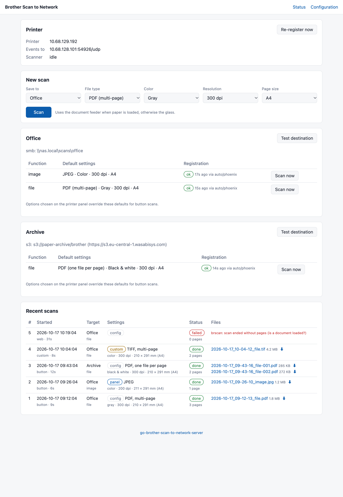
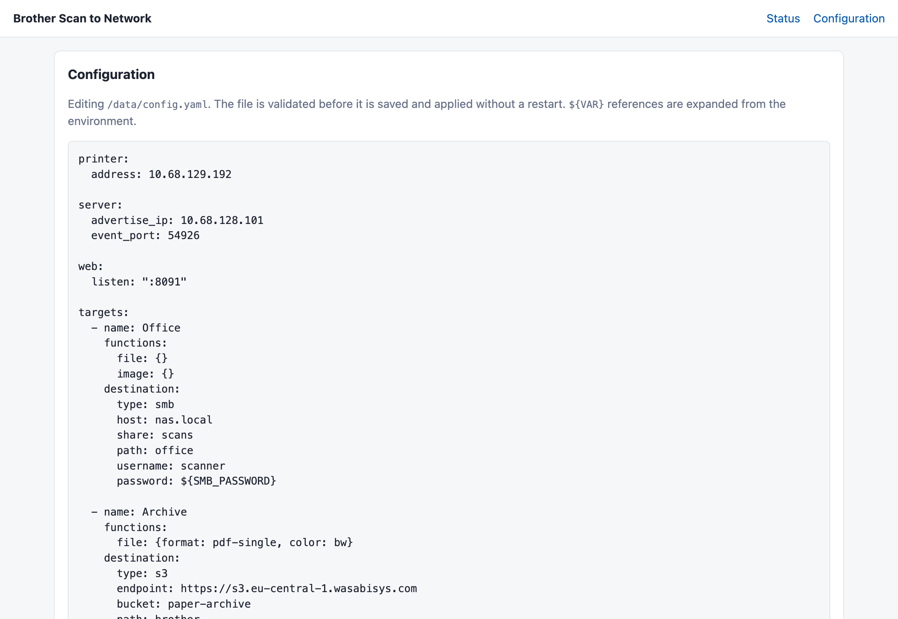

<h1 align="center">Brother Scan to Network</h1>

This fork adds source-IP filtering for button events, browser cross-origin
protection, fail-closed web access on invalid configuration, confined local file
access, and a patched Go toolchain. Build this fork from source to include those
changes; the upstream images referenced below do not include them. See
[SECURITY.md](SECURITY.md) for deployment guidance. If the configuration becomes
invalid, repair it on disk and restart the service.

<p align="center">
  <b>Press <i>Scan → PC</i> on your Brother printer and the document lands on your NAS, FTP server or S3 bucket.</b><br>
  No Brother software, no PC left running. One small Go service, one Docker container.
</p>

<p align="center">
  <a href="https://github.com/aurimasniekis/go-brother-scan-to-network-server/actions/workflows/ci.yml"></a>
  <a href="https://github.com/aurimasniekis/go-brother-scan-to-network-server/releases"></a>
  <a href="https://hub.docker.com/r/aurimasniekis/go-brother-scan-to-network-server"></a>
  <a href="https://goreportcard.com/report/github.com/aurimasniekis/go-brother-scan-to-network-server"></a>
  <a href="LICENSE"></a>
</p>

<p align="center">
  <picture>
    <source media="(prefers-color-scheme: dark)" srcset="docs/screenshots/dashboard-dark.png">
    
  </picture>
</p>

Many Brother multifunction printers can only *scan to PC*: the button works
only while Brother's software runs on a computer. This server takes that
computer's place. It registers with the printer exactly like Brother's tools
do, appears in the printer's **Scan → PC** list, receives the scan over the
network and stores it wherever you want.

## Features

- **Works from the printer panel.** Your server shows up as a "PC" in the
  *Scan to PC* menu; add as many entries as you like, each with its own destination.
- **Honours the panel options.** File type, color, resolution and single or
  multi-page chosen on the printer are used as-is.
- **Many formats.** PDF, TIFF (multi-page or one file per page), JPEG, PNG,
  BMP; color, gray or black & white. JPEGs from the scanner are embedded
  without re-encoding.
- **Anywhere you keep files.** SMB/Windows shares (no mount needed), FTP/FTPS,
  Amazon S3 and S3-compatible storage (MinIO, Cloudflare R2, Backblaze B2,
  Wasabi, …) or a local folder.
- **Document feeder support.** Multi-page scans from the ADF, or page by page
  from the glass with the printer's *next page?* prompt.
- **Web UI.** Registration status, a scan form with custom options, recent
  scans with download links, destination tests and a validating config editor.
- **Small and self-contained.** One static binary, a ~13 MB distroless image
  for amd64, arm64 and armv7.

## Quick start

### 1. Run the container

```yaml
# compose.yaml
services:
  brother-scan:
    image: aurimasniekis/go-brother-scan-to-network-server:latest
    container_name: brother-scan
    restart: unless-stopped
    network_mode: host            # the printer must reach UDP 54925
    environment:
      TZ: Europe/Vilnius          # local time in file names
      SMB_PASSWORD: change-me     # referenced from config.yaml as ${SMB_PASSWORD}
    volumes:
      - ./data:/data              # config.yaml and scan history
```

```sh
docker compose up -d
```

The image is also published as `ghcr.io/aurimasniekis/go-brother-scan-to-network-server`.

### 2. Configure

Open `http://<docker-host>:8080/config`. On first start the server writes a
commented example; replace it with your printer address and destination:

```yaml
printer:
  address: 192.168.1.50           # printer IP or hostname

targets:
  - name: NAS                     # name shown on the printer (max 15 characters)
    functions:
      file: {}                    # offer "File"; omit `functions` to offer all four
    destination:
      type: smb
      host: 192.168.1.20
      share: scans
      path: brother               # folder inside the share, created if missing
      username: scanner           # leave out for guest access
      password: ${SMB_PASSWORD}
```

Save; the configuration is validated and applied immediately. Use **Test
destination** on the dashboard to check the share is writable.

### 3. Scan

On the printer choose **Scan → PC**, pick **NAS**, select the function and
press Start. A few seconds later the file appears in the share and in the
dashboard's *Recent scans*.

## Installation options

<details>
<summary><b>Docker without host networking</b></summary>

With bridge networking, publish the ports and tell the server which address the
printer should send button events to (the container cannot see the host's LAN
address):

```sh
docker run -d --name brother-scan --restart unless-stopped \
  -p 8080:8080 -p 54925:54925/udp \
  -e TZ=Europe/Vilnius \
  -v ./data:/data \
  aurimasniekis/go-brother-scan-to-network-server
```

```yaml
server:
  advertise_ip: 192.168.1.10      # the Docker host's LAN address
```

The container runs as root so bind-mounted folders are writable whatever their
owner; set `user: "1000:1000"` (compose) or `--user 1000:1000` to run
unprivileged when the folders belong to that user.
</details>

<details>
<summary><b>Binary</b></summary>

Download an archive for Linux, macOS, Windows or FreeBSD from the
[releases](https://github.com/aurimasniekis/go-brother-scan-to-network-server/releases)
page, or build from source:

```sh
go install github.com/aurimasniekis/go-brother-scan-to-network-server/cmd/brother-scan-server@latest
brother-scan-server -config config.yaml
```

Flags: `-config` (env `CONFIG_PATH`, default `config.yaml`), `-log-level`
(env `LOG_LEVEL`: debug, info, warn, error), `-version`, `-healthcheck`.
</details>

## Configuration

The configuration is a YAML file (`/data/config.yaml` in Docker). It can be
edited in the web UI, which validates it before saving. `${NAME}` is replaced
from the environment, so secrets can stay out of the file.
[`config.yaml.example`](config.yaml.example) documents every option, with one
example target per destination type.

<picture>
  <source media="(prefers-color-scheme: dark)" srcset="docs/screenshots/config-dark.png">
  
</picture>

### Targets and scan settings

Each target is one entry in the printer's *Scan to PC* list.

```yaml
targets:
  - name: Office
    filename: '{{.Time.Format "2006/01"}}/scan_{{.Time.Format "02_150405"}}'
    functions:
      file:  {format: pdf, color: gray, resolution: 300}
      image: {format: jpeg, color: color}
      ocr:   {format: pdf-single, color: bw}
    destination: { ... }
```

| Option | Values | Default |
| --- | --- | --- |
| `name` | up to 15 characters | – |
| `filename` | Go template with `.Time`, `.Target`, `.Function`; `/` creates folders | `{{.Time.Format "2006-01-02_15-04-05"}}_{{.Function}}` |
| `pin` | numeric PIN asked on the panel | – |
| `functions` | any of `file`, `image`, `ocr`, `email` | all four |
| `functions.*.format` | `pdf`, `pdf-single`, `tiff`, `tiff-single`, `jpeg`, `png`, `bmp` | file/ocr/email: `pdf`, image: `jpeg` |
| `functions.*.color` | `color`, `gray`, `bw` | file/ocr: `gray`, email/image: `color` |
| `functions.*.resolution` | `100`, `200`, `300`, `600` | email: `200`, others `300` |
| `functions.*.page_size` | `a4`, `letter`, `legal`, `max` | `a4` |

**Panel options win.** When you choose options on the printer before
scanning, the printer scans with those and the server saves in the selected
format. The values above apply when the panel leaves them unset. PDF/A, Secure
PDF and Signed PDF are saved as plain PDF; XPS and the OCR text formats (TXT,
RTF, HTML) fall back to PDF, because the server does not run text recognition.

### Destinations

Every target has one destination. `path` is the folder (S3: key prefix)
inside it. Folders are created as needed, files are never overwritten (a `-1`,
`-2`, … suffix is added) and SMB/FTP uploads are renamed into place only when complete.

| Type | Options |
| --- | --- |
| `local` | `path` |
| `smb` | `host`, `share`, `path`, `username` (empty: guest), `password`, `domain`, `port` (445) |
| `ftp` | `host`, `path`, `username` (empty: anonymous), `password`, `tls` (`""`, `explicit`, `implicit`), `insecure_skip_verify`, `port` (21; 990 for implicit TLS) |
| `s3` | `bucket`, `path`, `region`, `access_key_id`, `secret_access_key`, `session_token`, `storage_class`, `endpoint` (empty: AWS), `path_style`, `insecure_skip_verify` |

<details>
<summary><b>Destination examples</b></summary>

```yaml
# FTPS
destination:
  type: ftp
  host: ftp.example.com
  path: scans
  username: scanner
  password: ${FTP_PASSWORD}
  tls: explicit

# Amazon S3
destination:
  type: s3
  bucket: my-scans
  path: brother
  region: eu-central-1
  access_key_id: ${S3_ACCESS_KEY_ID}
  secret_access_key: ${S3_SECRET_ACCESS_KEY}

# MinIO / self-hosted S3
destination:
  type: s3
  endpoint: http://192.168.1.20:9000
  path_style: true
  bucket: scans
  access_key_id: ${S3_ACCESS_KEY_ID}
  secret_access_key: ${S3_SECRET_ACCESS_KEY}

# Cloudflare R2
destination:
  type: s3
  endpoint: https://<account-id>.r2.cloudflarestorage.com
  region: auto
  bucket: scans
  access_key_id: ${S3_ACCESS_KEY_ID}
  secret_access_key: ${S3_SECRET_ACCESS_KEY}

# Local folder (mount it into the container)
destination:
  type: local
  path: /scans
```
</details>

### Printer, server and web UI

| Option | Default | Description |
| --- | --- | --- |
| `printer.address` | – | Printer IP or hostname (required) |
| `printer.registration` | `auto` | `auto` (HTTPS, then SNMP), `phoenix` or `snmp` |
| `printer.scan_protocol` | `native` | `native` (required for the panel button) or `escl` (AirScan, web scans only) |
| `server.advertise_ip` | detected | Address the printer sends button events to |
| `server.event_port` | `54925` | UDP port for button events |
| `web.listen` | `:8080` | Web UI address |
| `web.username` / `web.password` | – | Basic auth for the web UI |

## Compatibility

Tested with the **Brother MFC-L2800DW** (firmware 1.32). The protocols are the
ones Brother's *Push Scan Tool*, iPrint&Scan and the Linux `brscan` drivers
use, so other network-connected Brother printers and scanners with a
*Scan to PC* function should work: older models through SNMP registration,
newer ones through the HTTPS endpoint. Please
[report](https://github.com/aurimasniekis/go-brother-scan-to-network-server/discussions)
whether your model works.

## Troubleshooting

| Problem | What to check |
| --- | --- |
| The target is not in the printer's *Scan to PC* list | The dashboard's *Registration* column. Registrations last 6 minutes and are refreshed automatically; use **Re-register now** after changing names. |
| The scan starts but nothing arrives | The printer must reach UDP `54925` on the server: use host networking, or publish the port and set `server.advertise_ip`. Check firewalls. |
| `scanner busy (-NG 401)` | The printer is in use (panel menu open or another job). The server retries for a minute. |
| SMB login fails | Leave `username` empty for guest shares; otherwise check `domain` and that SMB2/3 is enabled on the NAS. |
| Wrong times in file names | Set `TZ` on the container. |

Run with `LOG_LEVEL=debug` for protocol details. `BRSCAN_CAPTURE_DIR=/data/captures`
saves the raw scanner stream of each scan, which is useful in bug reports.

## How it works

<details>
<summary>The printer protocols, reverse engineered from Brother's macOS and Linux software</summary>

1. **Registration.** The server sets the MIB value `1.3.6.1.4.1.2435.2.3.9.2.11.1.1.0`
   to `TYPE=BR;BUTTON=SCAN;DURATION=360;CC=1;HOST=<ip>:54925;USER="<name>";FUNC=<IMAGE|EMAIL|OCR|FILE>;APPNUM=<1|2|3|5>;`
   once per function, every 270–330 seconds. Newer firmware makes SNMP
   read-only, so the value is set through the printer's HTTPS endpoint
   (`POST /phoenix/mib`, HTTP Digest auth with the built-in `Public`/`0000`
   account, JSON body `{"request":[{"key":OID,"string_value":…}]}`). SNMP
   `set` remains as a fallback.
2. **Button event.** The printer sends a UDP datagram to port 54925: a 4-byte
   header (`02 00 xx 30`) and `KEY=VALUE;` pairs with `USER`, `FUNC`,
   `REGID` and `SEQ`. The server acknowledges it by echoing the datagram.
3. **Panel options.** The server connects to TCP 54921 (`+OK 200`) and sends
   `ESC GKP`; the reply lists the panel's settings as tags (`0x1002`
   resolution and color, `0x1005` file type and page splitting, …).
4. **Scan.** `ESC I` negotiates resolution and area, `ESC X` starts the scan.
   Pages arrive as JPEG blocks or PackBits rows (black & white), with
   end-of-page records and a final `0x80`. When panel options are set the
   printer uses an extended framing with 32-bit block lengths.
5. **Output.** Pages are assembled into PDF/TIFF (JPEG data is embedded as-is,
   black & white as 1-bit), converted for PNG/BMP, and uploaded.

Sources: Brother's macOS `NETserver` and `BRPhoenixConnection` (Push Scan Tool
2.3.1), `libLxBsScanCoreApi` from the Linux `brscan5` driver (analysed with
[REA](https://github.com/morluto/rea) and Ghidra), and
[brother-scand](https://github.com/rumpeltux/brother-scand), whose scan
command handling this builds on.
</details>

## Development

```sh
make help                     # all targets
make lint test                # gofmt, vet, unit tests (-race)
golangci-lint run             # linters used in CI
make run                      # run with ./config.yaml
make integration-servers integration-test integration-stop   # SMB/FTP/S3 against real servers
```

See [CONTRIBUTING.md](CONTRIBUTING.md). Releases are cut by pushing a
`vX.Y.Z` tag: CI publishes binaries, a GitHub release and multi-arch images to
Docker Hub and GHCR.

## Acknowledgements

- [brother-scand](https://github.com/rumpeltux/brother-scand) by Dariusz
  Stojaczyk and contributors for the documented scan protocol.
- [sane-airscan](https://github.com/alexpevzner/sane-airscan) for eSCL request
  details that work with Brother devices.
- [go-smb2](https://github.com/hirochachacha/go-smb2), [jlaffaye/ftp](https://github.com/jlaffaye/ftp)
  and [minio-go](https://github.com/minio/minio-go).

## License

[MIT](LICENSE). Brother and iPrint&Scan are trademarks of Brother Industries,
Ltd. This project is not affiliated with or endorsed by Brother.
